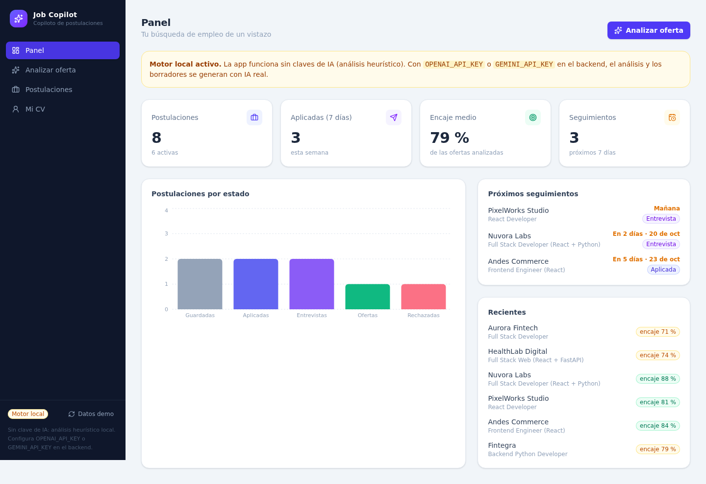
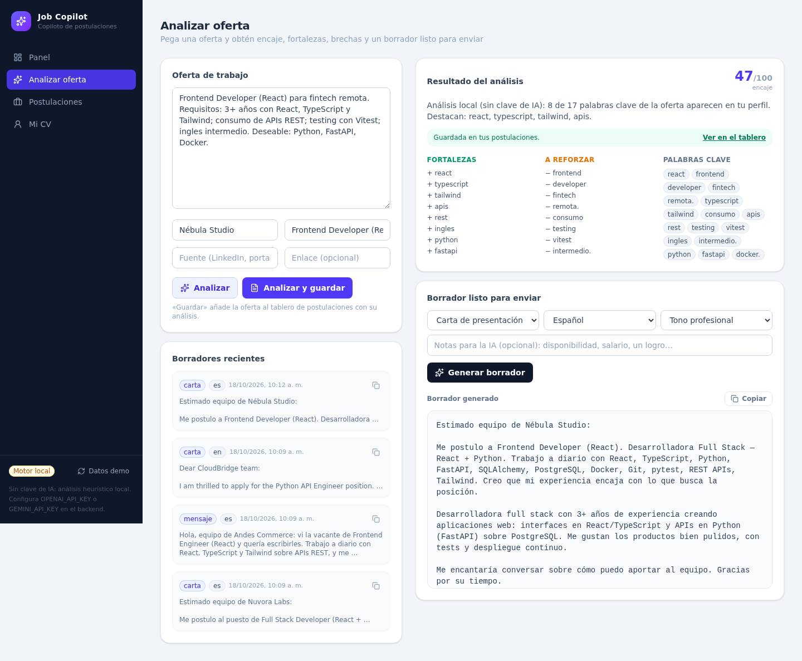
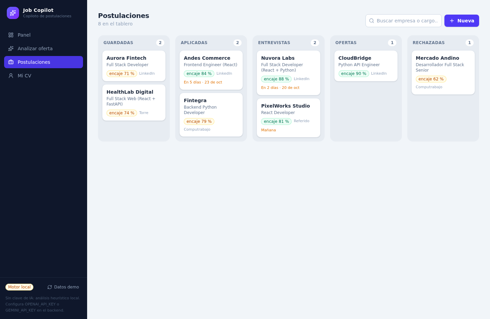
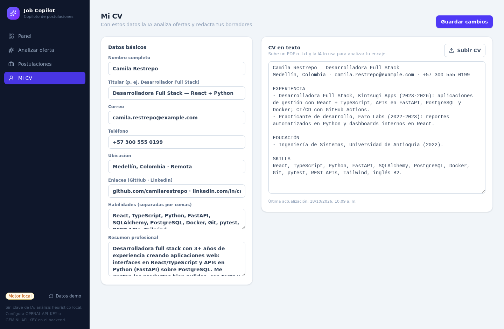

# Job Copilot 🧭

**Copiloto de postulaciones con IA:** analiza ofertas frente a tu perfil, calcula tu encaje, detecta brechas y redacta cartas, mensajes y seguimientos listos para enviar. Con tablero kanban para no perder el hilo de cada postulación.

> Proyecto de portafolio full stack: **React + TypeScript** en el frontend, **Python + FastAPI** en el backend, **SQLite/PostgreSQL** como base de datos y **IA con proveedor intercambiable** (OpenAI-compatible, Gemini o motor heurístico local sin claves).



## ✨ Qué hace

- **Analizar oferta** — pega el texto de una vacante y obtén:
  - *Fit score* (0–100) contra tu CV y habilidades.
  - Fortalezas y brechas concretas.
  - Palabras clave para tu CV y tus mensajes.
- **Borradores con IA** — genera carta de presentación, mensaje corto o seguimiento, en español o inglés, con 4 tonos. Todo queda guardado en un historial por postulación.
- **Tablero kanban** — cinco columnas: *guardada → aplicada → entrevista → oferta / rechazada*. Ficha lateral con notas, fecha de seguimiento, análisis y borradores. La fecha de aplicación se registra sola.
- **Panel de control** — métricas (activas, aplicadas en 7 días, encaje medio), gráfico por estado y próximos seguimientos.
- **Gestión de CV** — sube un PDF o TXT y el texto alimenta el análisis. Todo editable.

| Analizar oferta | Postulaciones | Mi CV |
| --- | --- | --- |
|  |  |  |

## 🧠 IA sin ataduras (y sin claves)

`LLM_PROVIDER` acepta:

| Valor | Qué usa |
| --- | --- |
| `auto` (por defecto) | La primera clave disponible: OpenAI-compatible → Gemini → heurístico |
| `openai` | Cualquier API compatible con OpenAI: OpenAI, Groq, OpenRouter, Together, **Ollama**, LM Studio, OmniRoute… (`OPENAI_BASE_URL`) |
| `gemini` | Google Gemini (`GEMINI_API_KEY`, capa gratuita) |
| `heuristic` | Motor local por reglas: sin red, sin claves, determinista |

**Sin configurar nada la app funciona completa** con el motor heurístico (así corren los tests y la demo). Si añades una clave, el análisis y los borradores pasan a generarse con IA real.

## 🚀 Cómo ejecutarlo

### 1. Backend (Python ≥ 3.11)

```bash
cd backend
python -m venv .venv && source .venv/bin/activate
pip install -e ".[dev]"
SEED_ON_STARTUP=true uvicorn app.main:app --reload
```

API en `http://127.0.0.1:8000` · documentación interactiva en `/docs`.
La seed carga un perfil y 8 postulaciones **ficticias** para que veas todo funcionando (también puedes restaurarlas desde el botón «Datos demo» o `POST /api/demo/reset`).

### 2. Frontend (Node ≥ 20)

```bash
cd frontend
npm install
npm run dev        # http://localhost:5173 (proxy /api → 127.0.0.1:8000)
```

Configura el backend con `backend/.env` (copia de `.env.example`): base de datos, CORS y claves de IA.

### 3. Docker (todo junto)

```bash
docker compose up --build
# web → http://localhost:8080 · api → http://localhost:8000
```

### Tests

```bash
cd backend
.venv/bin/python -m pytest        # 32 tests: API, análisis, borradores, perfiles y CV
cd ../frontend
npm run lint && npm run build     # oxlint + tsc + vite
```

## 🏗️ Estructura

```
job-copilot/
├── backend/
│   ├── app/
│   │   ├── api/routes/      # health, profile, applications, ai, dashboard, demo
│   │   ├── core/            # configuración (Pydantic Settings)
│   │   ├── db/              # engine + sesión SQLAlchemy
│   │   ├── models/          # Profile, Application, Draft
│   │   ├── schemas/         # contratos Pydantic
│   │   ├── services/        # llm.py (proveedores) · analysis.py (heurístico + prompts)
│   │   └── seed.py          # datos demo ficticios
│   └── tests/               # pytest (SQLite en memoria, sin red)
├── frontend/
│   └── src/
│       ├── components/      # layout, badges, modal…
│       ├── lib/             # cliente API, tipos, formato
│       └── pages/           # Panel · Analizar · Postulaciones · Mi CV
└── docker-compose.yml       # PostgreSQL + API + web (nginx)
```

## 📡 API principal

| Método | Ruta | Descripción |
| --- | --- | --- |
| `GET` | `/api/health` | Estado y proveedor de IA activo |
| `GET/PUT` | `/api/profile` | Perfil/CV |
| `POST` | `/api/profile/cv` | Subir CV (PDF/TXT) |
| `GET/POST` | `/api/applications` | Listar (con `?q=`) y crear postulaciones |
| `PATCH/DELETE` | `/api/applications/{id}` | Editar estado, notas, seguimiento… |
| `POST` | `/api/ai/analyze` | Analizar oferta (con `save=true` la guarda) |
| `POST/GET` | `/api/ai/drafts` | Generar y listar borradores |
| `GET` | `/api/dashboard` | Métricas del panel |
| `POST` | `/api/demo/reset` | Restaurar datos demo |

## 🔒 Privacidad

Los datos de ejemplo son **ficticios** (persona, empresas y vacantes inventadas). No hay ninguna credencial en el repositorio: las claves de IA viajan por variables de entorno.

## 🗺️ Roadmap

- [ ] Recordatorios de seguimiento por correo
- [ ] Importar ofertas desde URL (LinkedIn/portales)
- [ ] Etiquetas y búsqueda avanzada
- [ ] Multi-perfil (varios CVs)

---

## 🇬🇧 English

**Job Copilot** is an AI-powered job-application copilot: paste a job posting and get a **fit score** against your CV, strengths and gaps, keyword suggestions, and ready-to-send cover letters, short messages and follow-ups (ES/EN, 4 tones) — all tracked on a **kanban board** with notes, follow-up dates and a metrics dashboard.

**Stack:** React 19 + TypeScript + Tailwind (Vite) · Python + FastAPI + SQLAlchemy · SQLite (dev) / PostgreSQL (Docker) · pluggable LLM provider (any OpenAI-compatible API, Gemini, or a built-in deterministic heuristic engine that works offline with no API keys).

```bash
# API
cd backend && python -m venv .venv && source .venv/bin/activate
pip install -e ".[dev]" && SEED_ON_STARTUP=true uvicorn app.main:app --reload

# Web
cd frontend && npm install && npm run dev

# Everything with Docker
docker compose up --build
```

Run the tests with `pytest` (backend) and `npm run lint && npm run build` (frontend). Demo data is entirely fictional.

## 📄 Licencia

MIT — ver [LICENSE](LICENSE).
